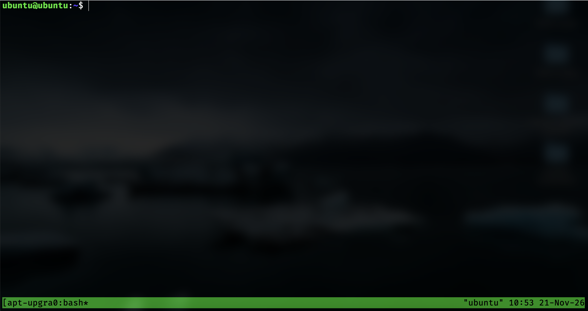

### Details

| Field | Detail |
| :--- | :--- |
| Date | 12 nov 2026 |
| Environment | Ubuntu Server VM on VMware |
| Host OS | macOS |
| Components / Services | `systemd-networkd`, `openssh-server`, `apt`, `tmux` |

---

### Breakdown

| Section | Description |
| :--- | :--- |
| **Issues** | • Ran `sudo apt upgrade` on active SSH session; hung and terminated with a `Broken pipe` error  • Local VM console confirmed upgrade continued running, but network was lost |
| **Attempts** | • Checked network interface: `ip a show ens33`; showed an IPv6 link-local address but no IPv4 (`inet`) address • Checked logs: `journalctl -u systemd-networkd` and encountered `lost carrier` and `DHCP lost` events • Tried to restart service: `sudo systemctl restart systemd-networkd` • Tried to renew DHCP lease: `sudo networkctl renew ens33` |
| **Fix** | • Rebooted the VM to force a clean DHCP lease • Confirmed the VM reacquired its reserved IPv4 address and reconnected via SSH |
| **Causes** | After some research I found out that upgrading core system/network packages can temporarily reset the virtual interface (`ens33`), hence server lost its connection to VMware's virtual switch just long enough to miss renewing its IP address |
| **Takeaways** | A simple fix to prevent remote session drops during long tasks is to use `tmux`: • Created a new tmux session (`tmux new -s apt-upgrade`) • Ran `sudo apt update && sudo apt upgrade -y` • Detached and let it run in the background (`Cmd + B -> D`) • Re-attached to verify and check progress (`tmux attach`) |

---

### Screenshots

